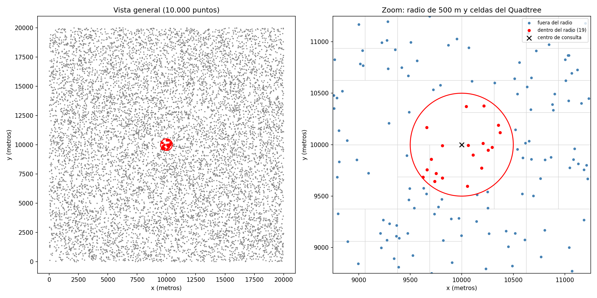
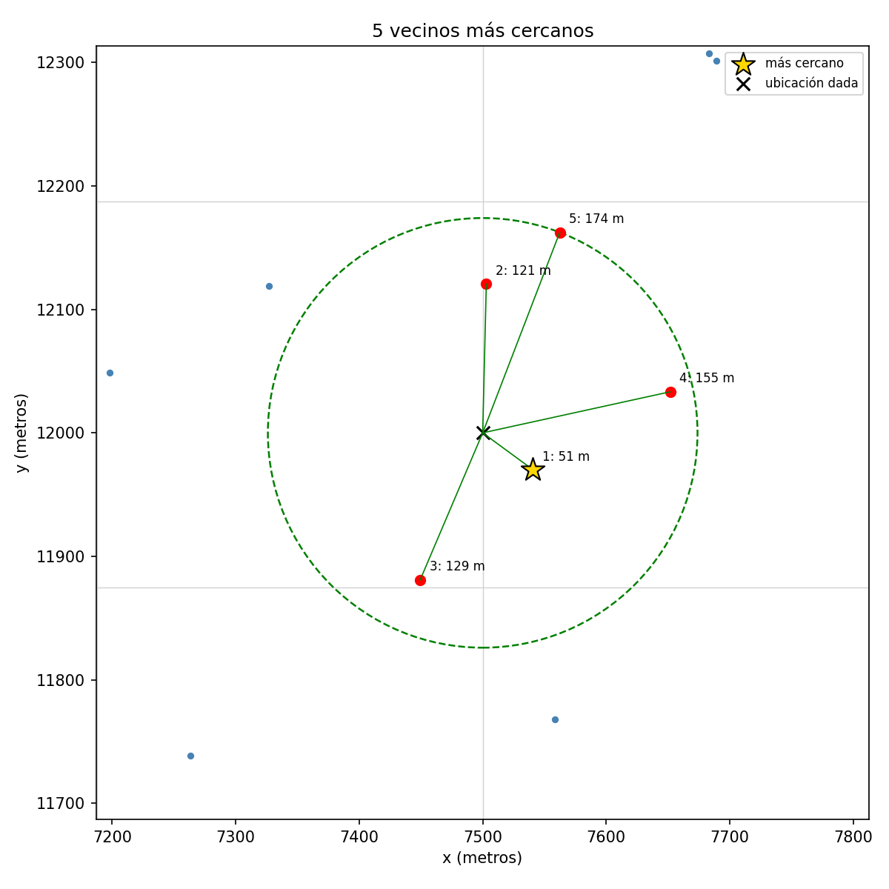
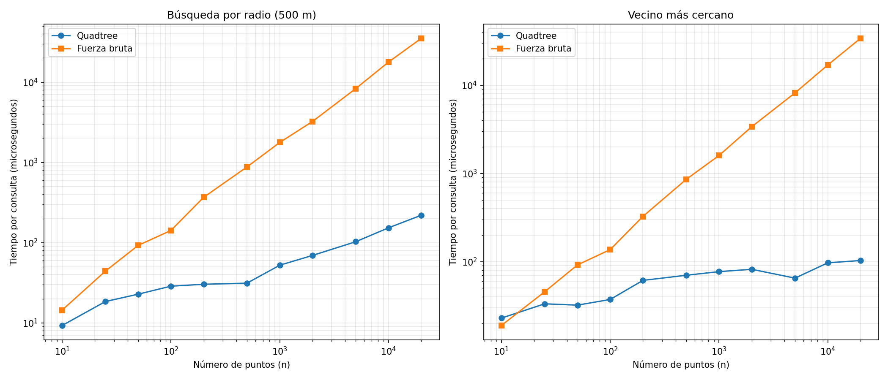
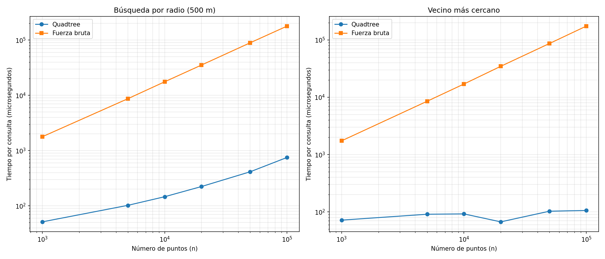
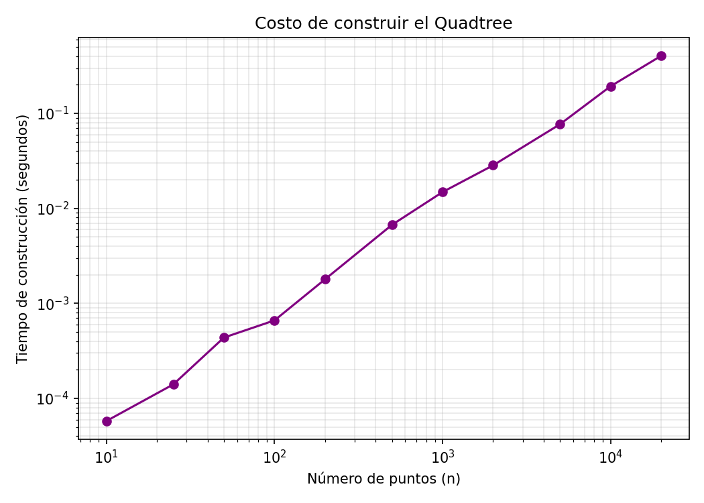
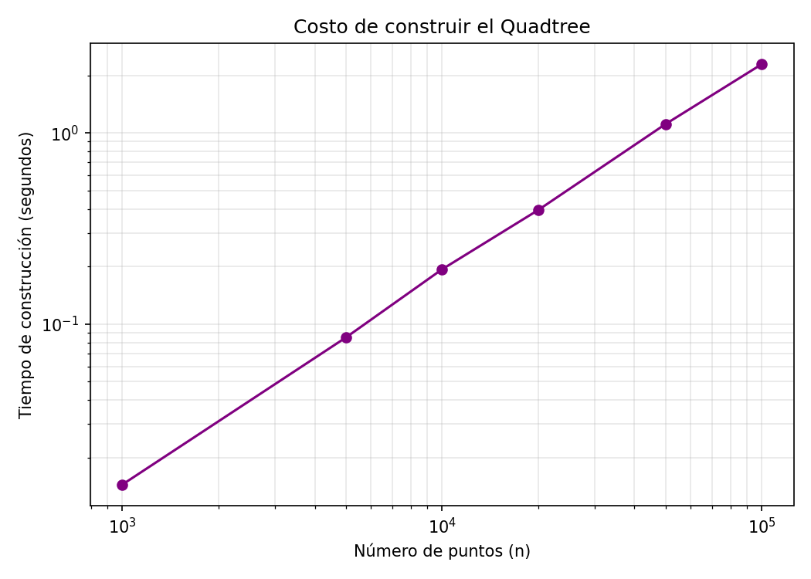
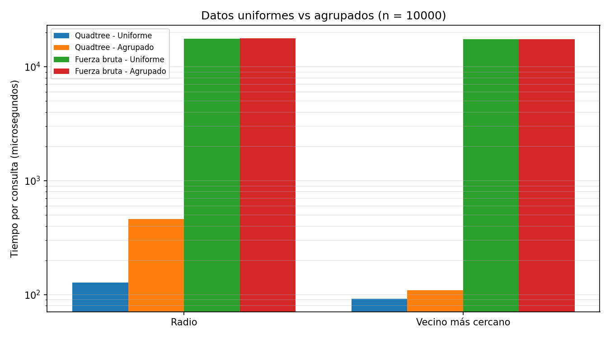
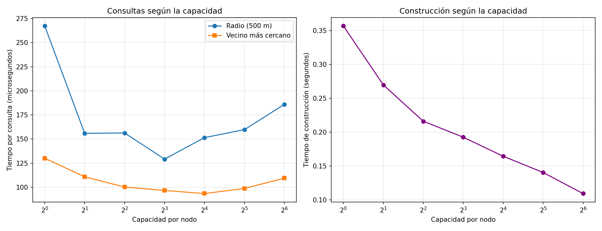
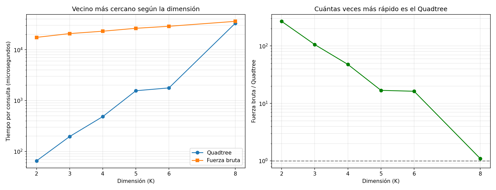

# Laboratorio 4: Quadtree para logística de entregas

Implementación desde cero de un Quadtree (generalizado a K dimensiones) para
responder consultas espaciales sobre 10.000 puntos de entrega, comparado con
fuerza bruta.

## Problema

Dados 10.000 puntos de entrega (x, y) en una ciudad de 20 km × 20 km
(coordenadas en **metros**), responder eficientemente:

- ¿Qué puntos están a un radio de 500 m de una ubicación dada?
- ¿Cuál es el punto de entrega más cercano a una ubicación dada?

## Estructura del repositorio

| Archivo | Contenido |
|---|---|
| `Quadtreetree.py` | Quadtree desde cero + funciones de fuerza bruta |
| `test.py` | Pruebas unitarias y visualizaciones de verificación |
| `analisis.py` | Benchmarks, experimentos extra y discusión de resultados |
| `graficas/` | Imágenes generadas por `test.py` y `analisis.py` |

## Entorno

- Python 3.13.2
- NumPy 2.2.4 y Matplotlib 3.10.1 (el árbol no usa ninguna librería de
  árboles; Matplotlib solo se usa para graficar).
- Datos generados con distribución uniforme y semilla fija, en una ciudad de
  20 km × 20 km, en metros. Los datos son estáticos.

## Cómo ejecutar

```
pip install numpy matplotlib
python test.py                   # pruebas unitarias + gráficas de verificación
python analisis.py               # benchmark principal (10 a 20.000 puntos)
python analisis.py grande        # tamaños grandes (1.000 a 100.000 puntos)
python analisis.py extra         # datos agrupados y capacidad por nodo
python analisis.py dimensiones   # rendimiento según la dimensión K
```

## Cómo funciona

- **Unidades**: metros. El radio de 500 m es literalmente `radio = 500`.
- **Construcción**: cada nodo cubre una región del espacio y guarda hasta 8
  puntos. Si se llena, se divide en partes iguales y reparte sus puntos entre
  los hijos. Solo las hojas guardan puntos.
- **K dimensiones**: un nodo se divide en 2^K hijos (4 en 2D, 8 en 3D). Las
  combinaciones se generan con `product((0, 1), repeat=k)`.
- **Búsqueda por radio**: en cada nodo se calcula la distancia mínima del
  centro a la caja del nodo. Si es mayor que el radio, se descarta todo ese
  subárbol. En las hojas se revisa cada punto.
- **Vecino más cercano y k vecinos**: se visitan primero los hijos más
  cercanos y se descartan las cajas más lejanas que el mejor resultado
  encontrado hasta ese momento.
- **Profundidad máxima**: evita recursión infinita con puntos duplicados.

## Verificación

Las 10 pruebas unitarias comparan el Quadtree contra fuerza bruta (2D y 3D) y
cubren bordes, duplicados, puntos fuera del rango y radios extremos.

### Búsqueda por radio



El círculo de 500 m encierra los 19 puntos encontrados, el mismo resultado de
la fuerza bruta. En el zoom se ven las celdas del Quadtree: son más pequeñas
donde hay más puntos.

### Vecinos más cercanos



Los 5 vecinos más cercanos (51, 121, 129, 155 y 174 m). El círculo punteado
tiene como radio la distancia al quinto vecino y no contiene otros puntos.

## Análisis comparativo

### ¿Desde qué tamaño el Quadtree es más rápido que la fuerza bruta?

- **Radio**: con 10 puntos el Quadtree ya gana, pero por muy poco; desde 25
  puntos la ventaja es clara.
- **Vecino más cercano**: con 10 puntos gana la fuerza bruta y con 25 gana el
  Quadtree. No medí tamaños entre 10 y 25, así que el cruce está en ese
  intervalo.
- Con 10 puntos, revisar la lista completa cuesta menos que recorrer el árbol
  y calcular distancias a las celdas. Con 10.000 puntos, el Quadtree es entre
  100 y 300 veces más rápido.



Tiempo por consulta (µs), promedio de 200 consultas aleatorias (una
ejecución; QT = Quadtree, FB = fuerza bruta):

| n | Radio QT | Radio FB | Cercano QT | Cercano FB |
|---:|---:|---:|---:|---:|
| 10 | 9,5 | 17,1 | 22,1 | 14,2 |
| 25 | 13,9 | 45,7 | 32,4 | 45,0 |
| 100 | 20,8 | 144,7 | 49,5 | 171,8 |
| 1.000 | 50,7 | 1.647,2 | 59,9 | 1.606,1 |
| 10.000 | 149,4 | 17.767,8 | 94,6 | 17.410,7 |
| 20.000 | 239,3 | 35.633,2 | 99,0 | 35.112,1 |

### Cómo crece cada método

La fuerza bruta revisa todos los puntos, así que si n se duplica, su tiempo se
duplica (O(n)). El Quadtree descarta zonas enteras y su tiempo crece mucho
menos, cercano a O(log n).

En el radio el Quadtree crece más que en el vecino más cercano porque, además
de buscar, tiene que devolver todos los puntos que caen dentro del círculo:
su costo es aproximadamente O(log n + k), con k = número de puntos
encontrados. Como la ciudad mide siempre lo mismo y se llena de puntos, k
aumenta con n. El vecino más cercano devuelve siempre un solo punto.

### Tamaños grandes

Con pocos puntos, cada consulta dura unas decenas de microsegundos y la
medición varía mucho de una corrida a otra. Por eso repetí el experimento con
tamaños de 1.000 a 100.000 puntos (30 consultas por tamaño), donde la
diferencia entre métodos es enorme frente al ruido.



| n | Radio QT | Radio FB | Cercano QT | Cercano FB |
|---:|---:|---:|---:|---:|
| 1.000 | 51,2 | 1.779,0 | 71,9 | 1.738,4 |
| 10.000 | 146,0 | 17.558,0 | 92,3 | 17.038,1 |
| 100.000 | 749,8 | 178.573,2 | 106,0 | 174.479,7 |

Al multiplicar n por 100 (de 1.000 a 100.000), la fuerza bruta tarda unas 100
veces más, el Quadtree en radio unas 15 veces más y el Quadtree en vecino más
cercano apenas 1,5 veces más. Con 100.000 puntos, el Quadtree es unas 240
veces más rápido en radio y unas 1.600 veces más rápido en vecino más cercano.

### Costo de construcción





Construir el árbol cuesta cerca de O(n log n): unos 0,19 s con 10.000 puntos y
0,40 s con 20.000. Ese costo se recupera con pocas consultas: para n ≥ 25,
entre 4 y 12 consultas en mis pruebas. Con datos estáticos y muchas
consultas, conviene construirlo.

En la gráfica de tamaños grandes, la construcción sube casi como una recta en
escala logarítmica, con una pendiente un poco mayor que 1: pasa de unos
0,015 s con 1.000 puntos a unos 2,3 s con 100.000. Al multiplicar n por 100,
el tiempo se multiplica por unos 150, lo cual es cercano a lo esperado para
O(n log n).

### Datos agrupados (zonas densas)

Se generaron 10.000 puntos concentrados en 10 zonas gaussianas (σ = 800 m,
como barrios) y se compararon con puntos uniformes.

| | Profundidad | Nodos | Puntos por radio | QT radio | FB radio | QT cercano | FB cercano |
|---|---:|---:|---:|---:|---:|---:|---:|
| Uniforme | 7 | 3.957 | 18,8 | 127,5 µs | 17.653 µs | 92,0 µs | 17.482 µs |
| Agrupado | 9 | 3.697 | 112,2 | 460,3 µs | 17.778 µs | 109,3 µs | 17.473 µs |



El árbol solo divide una celda cuando se llena. En las zonas densas las celdas
se llenan y se dividen muchas veces; en las zonas casi vacías no se dividen.
Por eso el árbol queda desbalanceado y la profundidad sube de 7 a 9. El
Quadtree tarda más en radio porque el círculo ahora encuentra 112 puntos en
lugar de 19; la fuerza bruta no cambia porque siempre revisa todos los puntos.
Aun así, el Quadtree sigue siendo unas 40 veces más rápido en radio y unas 160
veces en vecino más cercano.

### Capacidad por nodo



| Capacidad | Construcción | Profundidad | Nodos | Radio | Cercano |
|---:|---:|---:|---:|---:|---:|
| 1 | 0,357 s | 13 | 29.029 | 267 µs | 130 µs |
| 2 | 0,270 s | 10 | 14.541 | 156 µs | 111 µs |
| 4 | 0,216 s | 8 | 7.117 | 156 µs | 100 µs |
| 8 | 0,192 s | 7 | 3.957 | 129 µs | 97 µs |
| 16 | 0,164 s | 6 | 1.493 | 152 µs | 93 µs |
| 32 | 0,140 s | 5 | 1.225 | 160 µs | 99 µs |
| 64 | 0,109 s | 5 | 345 | 186 µs | 109 µs |

Con capacidad 1 el árbol es enorme y se visitan muchísimos nodos; con
capacidad 64 hay pocos nodos, pero cada hoja que toca el círculo se revisa
completa. Entre 2 y 32 los tiempos son parecidos (la diferencia está dentro
del ruido de medición); elegí 8 como un valor intermedio, sin afirmar que sea
el único bueno.

### Más de dos dimensiones

Con 10.000 puntos uniformes y capacidad 8, medí el vecino más cercano para
K = 2, 3, 4, 5, 6 y 8.



| K | Nodos | Quadtree | Fuerza bruta | Veces más rápido |
|---:|---:|---:|---:|---:|
| 2 | 3.957 | 65,1 µs | 17.466 µs | 268 |
| 3 | 4.681 | 195,9 µs | 20.735 µs | 106 |
| 4 | 4.513 | 483,3 µs | 23.093 µs | 48 |
| 5 | 22.177 | 1.559 µs | 26.336 µs | 17 |
| 6 | 4.417 | 1.773 µs | 28.879 µs | 16 |
| 8 | 65.793 | 32.999 µs | 36.078 µs | 1,1 |

La ventaja del Quadtree cae de cientos de veces en 2D a empatar con la fuerza
bruta en K = 8. La fuerza bruta casi no cambia (siempre revisa los mismos
10.000 puntos; solo cada distancia suma más coordenadas).

Por qué pasa: con más dimensiones los puntos quedan muy dispersos y el círculo
de búsqueda toca casi todas las celdas, así que casi no se puede descartar
nada. Además, cada división crea 2^K hijos: con K = 8 son 256 por nodo, y el
árbol llegó a 65.793 nodos con menos de un punto por celda. La cantidad de
nodos no crece de forma ordenada porque depende de si el número de puntos por
celda supera o no la capacidad de 8 (por ejemplo, K = 5 se divide mucho más
que K = 6). Esto es consistente con lo que describe la literatura sobre la
"maldición de la dimensionalidad" (ver Referencias).

Alcance: es una sola corrida, con un solo n y una sola capacidad, y no medí K
= 7 ni K > 8. Los valores de K = 2 y K = 3 cambiaron bastante entre corridas
(en K = 2 la razón estuvo entre 175 y 270); lo que se mantiene es la
tendencia y el empate cerca de K = 8.

### Limitaciones

- Los tiempos dependen del computador y cambian entre corridas.
- Está escrito en Python puro, que es lento; en un lenguaje compilado el
  punto de cruce sería otro.
- Los datos agrupados se probaron con un solo patrón de zonas.
- El experimento de dimensiones usa un solo n y una sola capacidad.

## Referencias

- Bentley, J. L. (1975). Multidimensional binary search trees used for
  associative searching. Communications of the ACM, 18(9), 509-517.
- Weber, R., Schek, H.-J. y Blott, S. (1998). A quantitative analysis and
  performance study for similarity-search methods in high-dimensional spaces.
  VLDB. https://www.vldb.org/conf/1998/p194.pdf
- Zilliz. La maldición de la dimensionalidad en el aprendizaje automático
  (glosario). https://zilliz.com/es/glossary/curse-of-dimensionality-in-machine-learning

## Uso de inteligencia artificial

Usé Claude (Anthropic) como apoyo durante el laboratorio. La IA propuso mejoras a la
estructura del proyecto y las decisiones de diseño, y generó borradores del
código del Quadtree, de las pruebas y de los benchmarks. Yo ejecuté y probé el
código, resolví los problemas de mi entorno, revisé las gráficas e interpreté
los resultados. En la segunda etapa, siguiendo las indicaciones del profesor,
escribí con guía el generador de puntos en K dimensiones, la función de
medición por dimensión y los cambios para el experimento de tamaños grandes, y
estudié el código y los resultados para poder explicarlos.